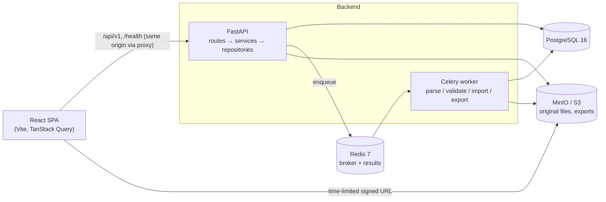

# Architecture

## System overview



## Backend layering

| Layer | Location | Responsibility |
|---|---|---|
| Routes | `app/api/` | HTTP only: parse input, call one service, shape the response. No business logic. |
| Dependencies | `app/core/dependencies.py` | Inject the DB session, current user, permissions and services. |
| Services | `app/services/` | Business rules: parsing, mapping, validation, import, tree, roll-up, diff, export, audit. |
| Repositories | `app/repositories/` | SQLAlchemy queries, always scoped by workspace membership. |
| Models / Schemas | `app/models/`, `app/schemas/` | ORM tables; Pydantic request and response contracts. |
| Workers | `app/workers/` | Celery tasks that call the same async services through `asyncio.run`. |

### Cross-cutting concerns (Phase 0)

- **Configuration:** `app/core/config.py`. Pydantic Settings reads environment variables.
  Production refuses to start without a strong `JWT_SECRET_KEY` and a secure refresh cookie.
- **Logging:** `app/core/logging.py`. Logs are single-line JSON. `request_id` is attached
  automatically, and `bom_upload_id`, `workspace_id`, `user_id` and `job_id` are added when
  passed via `extra=`.
- **Request context:** `app/core/middleware.py`.
  - Assigns or propagates `X-Request-ID`, rejecting unsafe incoming values.
  - Writes an access log line for each request.
  - Converts unhandled exceptions into a generic `INTERNAL_ERROR`, so no stack trace ever
    reaches a client.
- **Errors:** `app/core/exceptions.py`. Every non-2xx response uses the envelope
  `{"error": {"code", "message", "details", "request_id"}}`.
- **Health:** `GET /health` (liveness) and `GET /health/ready` (database, Redis and storage
  checked concurrently with a timeout; 503 when degraded, without leaking error details).

### Authentication and authorization (Phase 1)

The endpoint contract, error codes and limits are in [API.md](API.md). The
tables are in [DATABASE.md](DATABASE.md#authentication-and-workspace-tables-phase-1).

| Concern | Location |
|---|---|
| Password hashing, JWT encode/decode, refresh-token generation and hashing | `app/core/security.py` |
| Register, login, refresh, logout, access-token authentication | `app/services/auth_service.py` |
| Per-(email, IP) progressive throttle | `app/services/login_throttle.py` |
| Fixed-window rate limits (Redis), per client IP or per user | `app/services/rate_limiter.py` |
| Client IP behind trusted proxies, IPv6 /64 identity | `app/core/client_ip.py` |
| Role → permission policy | `app/core/permissions.py` |
| Current user and workspace-permission dependencies | `app/core/dependencies.py` |
| Audit trail | `app/services/audit_service.py` |

**Token lifecycle.**

- Login returns a short-lived access JWT (HS256, `ACCESS_TOKEN_TTL_MINUTES`, default 15) and
  sets the `bomviz_refresh` cookie.
- The access JWT carries `sub` (user id), `sid` (refresh family id), `iss`, `aud`, `typ`,
  `iat` and `exp`. Decoding pins the algorithm and requires every claim.
- The refresh token is a random value that the server stores only as a SHA-256 hash. Each
  login starts a new token family (one family per session).
- Every authenticated request loads the user, who must exist and be active. It also checks
  that the token's `sid` family still has an unrevoked, unexpired refresh token. Logout and
  reuse detection therefore invalidate outstanding access tokens immediately, not when they
  expire.
- Sessions have an absolute lifetime: `REFRESH_TOKEN_TTL_DAYS` from login. A rotated token
  inherits its predecessor's `expires_at`, and the cookie's `Max-Age` is the time the session
  has left.
- Logout locks the presented token's row (the same lock refresh takes), then revokes its whole
  family and clears the cookie. A concurrent refresh therefore either finishes first, and its
  successor is revoked too, or runs afterwards and finds the token revoked.

**Rotation and reuse detection.** `POST /auth/refresh` locks the presented token's row
(`SELECT … FOR UPDATE`).

- Valid token: it is revoked, a successor is inserted in the same family (`replaced_by_id`
  links them), and a new access token is returned.
- Revoked token that was rotated (`replaced_by_id` set): this is treated as theft. Every
  refresh token of that user is revoked, `AUTH_REFRESH_REUSED` is audited, the cookie is
  cleared, and the response is `401 TOKEN_REUSED`.
- Revoked token with no successor (revoked by logout): `401 TOKEN_INVALID`, and nothing else is
  revoked. Replaying a signed-out cookie therefore cannot sign the user out everywhere.

**Login hardening.** The checks run in this order:

1. A per-IP rate limit (30 per 15 minutes).
2. The progressive throttle for the (email, IP) pair. If the pair is blocked, the response is
   `429 LOGIN_THROTTLED` and the password is not checked.
3. Password verification. An unknown email is verified against a fixed dummy hash so timing
   stays uniform. Wrong password, unknown email and inactive account all return the same 401
   and increment the pair's counter.

The first three failures are free. From the fourth on, the pair is blocked for 30 s, doubling up
to 900 s. Counters reset after 24 hours without a failure. A successful login deletes the
counter. Attempts on one pair take a transaction-scoped advisory lock
(`pg_advisory_xact_lock`) before the block check, so concurrent attempts run one at a time.
A burst of parallel requests on a fresh pair gets no more password checks than sequential
attempts would.

The throttle is per pair rather than a per-account lockout, so an attacker on one IP cannot lock
the real user out from another. Throttle rows and failed-login audits are committed before the
error is raised, so they persist even though the request's unit of work rolls back. Redis rate
limits fail open; the throttle lives in PostgreSQL.

**Client IP.** `get_client_ip` in `app/core/dependencies.py` supplies the identity for rate
limits and the throttle:

- `X-Forwarded-For` is ignored unless the direct peer is in `TRUSTED_PROXY_IPS`
  (comma-separated IPs or CIDRs, default empty). If the peer is trusted, the right-most entry
  that is not a trusted proxy is used.
- IPv4-mapped IPv6 addresses become IPv4. Other IPv6 addresses are keyed by their /64.
- An invalid `TRUSTED_PROXY_IPS` entry fails settings validation at startup.

In Docker Compose, every service is on the `bomviz` network (`172.30.0.0/24`). The frontend
container has the fixed address `172.30.0.10`, which is the backend's `TRUSTED_PROXY_IPS`, and
its Vite dev proxy sends `X-Forwarded-For` (`xfwd`). Requests sent straight to the host's port
8000 come from the network gateway, which is outside the trusted set, so they cannot spoof the
header.
Behind any other reverse proxy or load balancer, set `TRUSTED_PROXY_IPS` to its address.
Otherwise all clients share the proxy's identity, so the IP rate limits become global and the
login throttle becomes per email (see "Client IP" in [API.md](API.md)).

Adding a member by email is also rate-limited, per acting user (30 per hour), because its
`404 USER_NOT_FOUND` reveals whether an account exists.

**Authorization.** Roles are per workspace (`workspace_members.role`). `permissions.py` maps
each role to permissions and denies by default:

| Role | Permissions |
|---|---|
| `ADMIN` | `workspace:read`, `workspace:manage_members`, `product:read`, `product:write` |
| `ENGINEER` | `workspace:read`, `product:read`, `product:write` |
| `PROCUREMENT`, `PRODUCTION`, `VIEWER` | `workspace:read`, `product:read` |

`require_workspace_permission(permission)` resolves the workspace and the caller's membership in
one query scoped to the current user. A non-member, or a workspace that does not exist, gets
`404 NOT_FOUND`. A member without the permission gets `403 FORBIDDEN`. Products and revisions
are resolved through their workspace membership in the same way.

**Member removal and audit preservation.**

- The last `ADMIN` of a workspace can never be demoted or removed (`409 LAST_ADMIN`). The
  workspace's ADMIN rows are locked before counting, so two concurrent demotions cannot both
  succeed.
- Removal deletes only the `workspace_members` row, never the user.
- Removal is audited as `MEMBER_REMOVED` with the actor, workspace, membership id, target user
  id, previous role and timestamp.
- Audit rows reference `users`, not memberships, so a removed member's history survives.
  `audit_logs.workspace_id` is `ON DELETE RESTRICT` and `actor_id` is `ON DELETE SET NULL`.
- Audit metadata never contains emails, IP addresses, passwords, tokens or throttle key
  hashes.

**Frontend session.**

- `src/lib/auth-session.ts` keeps the access token in memory only, never in `localStorage` or
  `sessionStorage`. On load, `AuthProvider` restores the session by calling `/auth/refresh`
  and then `/auth/me`.
- `refreshAccessToken()` is single-flight within a tab. Across tabs it is serialized with the
  Web Locks API (`navigator.locks`, lock `bomviz-refresh`) when the browser supports it.
  Without the lock, two tabs rotating the same cookie at once would look like token reuse and
  revoke every session.
- Logout runs inside the same `bomviz-refresh` lock, so it never overlaps a refresh in another
  tab.
- `apiRequest` in `src/lib/api-client.ts` attaches the bearer token. On a 401 with
  `TOKEN_EXPIRED` or `TOKEN_INVALID` it refreshes once and retries once.
- Only a 401 refresh rejection (`UNAUTHENTICATED`, `TOKEN_INVALID`, `TOKEN_EXPIRED`,
  `TOKEN_REUSED`) ends the session. A 429, a 5xx or a network error keeps the session and
  surfaces the error, so the user can retry instead of being signed out.
- `ClearQueryCacheOnSignOut` handles the two ways cached data could leak to another user:
  - When the session ends (sign-out or a rejected refresh), it clears the whole TanStack Query
    cache.
  - When a token for a different user arrives without a sign-out (the JWT `sub` changes, for
    example because another tab signed in as someone else and this tab's refresh picked up
    the new cookie), it clears the mutation cache and resets every query. Active queries then
    refetch with the new user's token, and `AuthProvider` reloads `/auth/me`.
- `RequireAuth` redirects anonymous users to `/login?next=<path>`. Only same-origin relative
  paths are accepted as `next`.
- The last-used workspace id is kept in `localStorage` as a convenience only; it is never
  trusted for access.

## Frontend structure

```
src/
  app/          App, router, layouts, top-level pages
  components/   shared components; components/ui = shadcn/ui primitives
  features/     one folder per feature: api.ts (TanStack Query hooks), components, schemas, tests
  lib/          api client (error envelope → ApiError), in-memory auth session, query client, utilities
  tests/        Vitest setup, MSW server, render helpers
```

- Server state lives only in TanStack Query. View state (tree vs. flat, filters, build
  quantity) lives in URL search params, so toggling views loses nothing and views can be
  shared as links.
- The large tree and flat tables are virtualized. React Flow is used for where-used and
  dependency graphs.

## Key decisions

- [ADR 0001](adr/0001-hierarchy-and-rollup.md) covers the hierarchy model, MRP roll-up and
  error-row exclusion.
- **One async code path.** Celery tasks run the async services, so there are no duplicate sync
  repositories.
- **The original file is the staging area.** Preview, validation and import re-read the
  immutable original from object storage. Import re-validates inside its transaction.
- **Auth.** The access JWT (15 min) is kept in memory on the client. The refresh token is an
  httpOnly `SameSite=Strict` cookie, hashed server-side and rotated on every use. Reusing a
  rotated token revokes all of that user's sessions. A session lives at most
  `REFRESH_TOKEN_TTL_DAYS` from login. See
  [Authentication and authorization](#authentication-and-authorization-phase-1).
- **Tenancy.** Every query is scoped by workspace membership. A resource in another workspace
  returns 404, so its existence is not leaked.
- **Signed URLs** are generated against `S3_PUBLIC_ENDPOINT_URL` and expire after
  `SIGNED_URL_TTL_SECONDS`.

## Delivery phases

| Phase | Scope |
|---|---|
| 0 | Foundation: repo, Docker Compose, FastAPI/React shells, config, logging, health, Alembic, CI |
| 1 | Auth: users, JWT + refresh rotation, login throttling, per-workspace RBAC, workspaces and members, products and revisions, audit log |
| 2 | Upload & parsing |
| 3 | Column mapping & validation |
| 4 | Import, state machine, audit, retry, soft delete |
| 5 | Tree, flattened roll-up, toggle, search & filters |
| 6 | Where-used, diff |
| 7 | Exports, polish, E2E, release |
