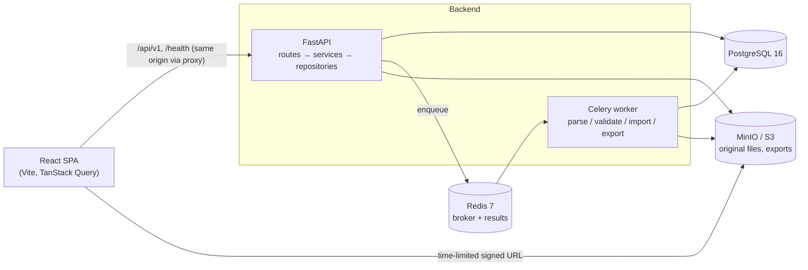

# Architecture

## System overview



## Backend layering

| Layer | Location | Responsibility |
|---|---|---|
| Routes | `app/api/` | HTTP only: parse input, call one service, shape the response. No business logic. |
| Dependencies | `app/core/dependencies.py` | Inject the DB session, current user, permissions and services. |
| Services | `app/services/` | Business rules: parsing, mapping, validation, import, tree, roll-up, diff, export, audit. |
| Repositories | `app/repositories/` | SQLAlchemy queries, always scoped by workspace membership. |
| Models / Schemas | `app/models/`, `app/schemas/` | ORM tables; Pydantic request and response contracts. |
| Workers | `app/workers/` | Celery tasks that call the same async services through `asyncio.run`. |

### Cross-cutting concerns (Phase 0)

- **Configuration:** `app/core/config.py`. Pydantic Settings reads environment variables.
  Production refuses to start without a strong `JWT_SECRET_KEY` and a secure refresh cookie.
- **Logging:** `app/core/logging.py`. Logs are single-line JSON. `request_id` is attached
  automatically, and `bom_upload_id`, `workspace_id`, `user_id` and `job_id` are added when
  passed via `extra=`.
- **Request context:** `app/core/middleware.py`.
  - Assigns or propagates `X-Request-ID`, rejecting unsafe incoming values.
  - Writes an access log line for each request.
  - Converts unhandled exceptions into a generic `INTERNAL_ERROR`, so no stack trace ever
    reaches a client.
- **Errors:** `app/core/exceptions.py`. Every non-2xx response uses the envelope
  `{"error": {"code", "message", "details", "request_id"}}`.
- **Health:** `GET /health` (liveness) and `GET /health/ready` (database, Redis and storage
  checked concurrently with a timeout; 503 when degraded, without leaking error details).

## Frontend structure

```
src/
  app/          App, router, layouts, top-level pages
  components/   shared components; components/ui = shadcn/ui primitives
  features/     one folder per feature: api.ts (TanStack Query hooks), components, schemas, tests
  lib/          api client (error envelope → ApiError), query client, utilities
  tests/        Vitest setup, MSW server, render helpers
```

- Server state lives only in TanStack Query. View state (tree vs. flat, filters, build
  quantity) lives in URL search params, so toggling views loses nothing and views can be
  shared as links.
- The large tree and flat tables are virtualized. React Flow is used for where-used and
  dependency graphs.

## Key decisions

- [ADR 0001](adr/0001-hierarchy-and-rollup.md) covers the hierarchy model, MRP roll-up and
  error-row exclusion.
- **One async code path.** Celery tasks run the async services, so there are no duplicate sync
  repositories.
- **The original file is the staging area.** Preview, validation and import re-read the
  immutable original from object storage. Import re-validates inside its transaction.
- **Auth.** The access JWT (15 min) is kept in memory on the client. The refresh token is an
  httpOnly `SameSite=Strict` cookie, hashed server-side and rotated on every use. Reusing a
  rotated token revokes all of that user's sessions.
- **Tenancy.** Every query is scoped by workspace membership. A resource in another workspace
  returns 404, so its existence is not leaked.
- **Signed URLs** are generated against `S3_PUBLIC_ENDPOINT_URL` and expire after
  `SIGNED_URL_TTL_SECONDS`.

## Delivery phases

| Phase | Scope |
|---|---|
| 0 | Foundation: repo, Docker Compose, FastAPI/React shells, config, logging, health, Alembic, CI |
| 1 | Auth: users, JWT + refresh rotation, RBAC, workspaces |
| 2 | Upload & parsing |
| 3 | Column mapping & validation |
| 4 | Import, state machine, audit, retry, soft delete |
| 5 | Tree, flattened roll-up, toggle, search & filters |
| 6 | Where-used, diff |
| 7 | Exports, polish, E2E, release |
