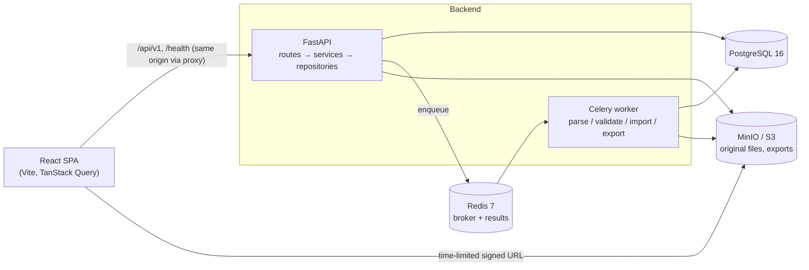
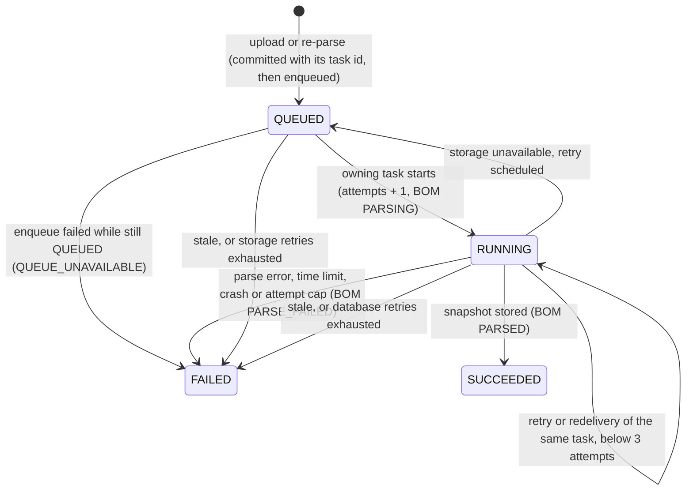

# Architecture

## System overview



## Backend layering

| Layer | Location | Responsibility |
|---|---|---|
| Routes | `app/api/` | HTTP only: parse input, call one service, shape the response. No business logic. |
| Dependencies | `app/core/dependencies.py` | Inject the DB session, current user, permissions and services. |
| Services | `app/services/` | Business rules: parsing, mapping, validation, import, tree, roll-up, diff, export, audit. |
| Repositories | `app/repositories/` | SQLAlchemy queries, always scoped by workspace membership. |
| Models / Schemas | `app/models/`, `app/schemas/` | ORM tables; Pydantic request and response contracts. |
| Workers | `app/workers/` | Celery tasks that call the same async services through `asyncio.run`. |

### Cross-cutting concerns (Phase 0)

- **Configuration:** `app/core/config.py`. Pydantic Settings reads environment variables.
  Production refuses to start without a strong `JWT_SECRET_KEY` and a secure refresh cookie.
- **Logging:** `app/core/logging.py`. Logs are single-line JSON. `request_id` is attached
  automatically, and `bom_upload_id`, `workspace_id`, `user_id` and `job_id` are added when
  passed via `extra=`.
- **Request context:** `app/core/middleware.py`.
  - Assigns or propagates `X-Request-ID`, rejecting unsafe incoming values.
  - Writes an access log line for each request.
  - Converts unhandled exceptions into a generic `INTERNAL_ERROR`, so no stack trace ever
    reaches a client.
- **Errors:** `app/core/exceptions.py`. Every non-2xx response uses the envelope
  `{"error": {"code", "message", "details", "request_id"}}`.
- **Health:** `GET /health` (liveness) and `GET /health/ready` (database, Redis and storage
  checked concurrently with a timeout; 503 when degraded, without leaking error details).

### Authentication and authorization (Phase 1)

The endpoint contract, error codes and limits are in [API.md](API.md). The
tables are in [DATABASE.md](DATABASE.md#authentication-and-workspace-tables-phase-1).

| Concern | Location |
|---|---|
| Password hashing, JWT encode/decode, refresh-token generation and hashing | `app/core/security.py` |
| Register, login, refresh, logout, access-token authentication | `app/services/auth_service.py` |
| Per-(email, IP) progressive throttle | `app/services/login_throttle.py` |
| Fixed-window rate limits (Redis), per client IP or per user | `app/services/rate_limiter.py` |
| Client IP behind trusted proxies, IPv6 /64 identity | `app/core/client_ip.py` |
| Role → permission policy | `app/core/permissions.py` |
| Current user and workspace-permission dependencies | `app/core/dependencies.py` |
| Audit trail | `app/services/audit_service.py` |

**Token lifecycle.**

- Login returns a short-lived access JWT (HS256, `ACCESS_TOKEN_TTL_MINUTES`, default 15) and
  sets the `bomviz_refresh` cookie.
- The access JWT carries `sub` (user id), `sid` (refresh family id), `iss`, `aud`, `typ`,
  `iat` and `exp`. Decoding pins the algorithm and requires every claim.
- The refresh token is a random value that the server stores only as a SHA-256 hash. Each
  login starts a new token family (one family per session).
- Every authenticated request loads the user, who must exist and be active. It also checks
  that the token's `sid` family still has an unrevoked, unexpired refresh token. Logout and
  reuse detection therefore invalidate outstanding access tokens immediately, not when they
  expire.
- Sessions have an absolute lifetime: `REFRESH_TOKEN_TTL_DAYS` from login. A rotated token
  inherits its predecessor's `expires_at`, and the cookie's `Max-Age` is the time the session
  has left.
- Logout locks the presented token's row (the same lock refresh takes), then revokes its whole
  family and clears the cookie. A concurrent refresh therefore either finishes first, and its
  successor is revoked too, or runs afterwards and finds the token revoked.

**Rotation and reuse detection.** `POST /auth/refresh` locks the presented token's row
(`SELECT … FOR UPDATE`).

- Valid token: it is revoked, a successor is inserted in the same family (`replaced_by_id`
  links them), and a new access token is returned.
- Revoked token that was rotated (`replaced_by_id` set): this is treated as theft. Every
  refresh token of that user is revoked, `AUTH_REFRESH_REUSED` is audited, the cookie is
  cleared, and the response is `401 TOKEN_REUSED`.
- Revoked token with no successor (revoked by logout): `401 TOKEN_INVALID`, and nothing else is
  revoked. Replaying a signed-out cookie therefore cannot sign the user out everywhere.

**Login hardening.** The checks run in this order:

1. A per-IP rate limit (30 per 15 minutes).
2. The progressive throttle for the (email, IP) pair. If the pair is blocked, the response is
   `429 LOGIN_THROTTLED` and the password is not checked.
3. Password verification. An unknown email is verified against a fixed dummy hash so timing
   stays uniform. Wrong password, unknown email and inactive account all return the same 401
   and increment the pair's counter.

The first three failures are free. From the fourth on, the pair is blocked for 30 s, doubling up
to 900 s. Counters reset after 24 hours without a failure. A successful login deletes the
counter. Attempts on one pair take a transaction-scoped advisory lock
(`pg_advisory_xact_lock`) before the block check, so concurrent attempts run one at a time.
A burst of parallel requests on a fresh pair gets no more password checks than sequential
attempts would.

The throttle is per pair rather than a per-account lockout, so an attacker on one IP cannot lock
the real user out from another. Throttle rows and failed-login audits are committed before the
error is raised, so they persist even though the request's unit of work rolls back. Redis rate
limits fail open; the throttle lives in PostgreSQL.

**Client IP.** `get_client_ip` in `app/core/dependencies.py` supplies the identity for rate
limits and the throttle:

- `X-Forwarded-For` is ignored unless the direct peer is in `TRUSTED_PROXY_IPS`
  (comma-separated IPs or CIDRs, default empty). If the peer is trusted, the right-most entry
  that is not a trusted proxy is used.
- IPv4-mapped IPv6 addresses become IPv4. Other IPv6 addresses are keyed by their /64.
- An invalid `TRUSTED_PROXY_IPS` entry fails settings validation at startup.

In Docker Compose, every service is on the `bomviz` network (`172.30.0.0/24`). The frontend
container has the fixed address `172.30.0.10`, which is the backend's `TRUSTED_PROXY_IPS`, and
its Vite dev proxy sends `X-Forwarded-For` (`xfwd`). Requests sent straight to the host's port
8000 come from the network gateway, which is outside the trusted set, so they cannot spoof the
header.
Behind any other reverse proxy or load balancer, set `TRUSTED_PROXY_IPS` to its address.
Otherwise all clients share the proxy's identity, so the IP rate limits become global and the
login throttle becomes per email (see "Client IP" in [API.md](API.md)).

Adding a member by email is also rate-limited, per acting user (30 per hour), because its
`404 USER_NOT_FOUND` reveals whether an account exists.

**Authorization.** Roles are per workspace (`workspace_members.role`). `permissions.py` maps
each role to permissions and denies by default:

| Role | Permissions |
|---|---|
| `ADMIN` | `workspace:read`, `workspace:manage_members`, `product:read`, `product:write`, `bom:read`, `bom:upload` |
| `ENGINEER` | `workspace:read`, `product:read`, `product:write`, `bom:read`, `bom:upload` |
| `PROCUREMENT`, `PRODUCTION`, `VIEWER` | `workspace:read`, `product:read`, `bom:read` |

`require_workspace_permission(permission)` resolves the workspace and the caller's membership in
one query scoped to the current user. A non-member, or a workspace that does not exist, gets
`404 NOT_FOUND`. A member without the permission gets `403 FORBIDDEN`. Products and revisions
are resolved through their workspace membership in the same way, and so are BOMs
(`require_bom_permission` in `app/api/boms.py`). The upload receives its workspace id as a form
field, so it calls `check_workspace_permission` directly.

**Member removal and audit preservation.**

- The last `ADMIN` of a workspace can never be demoted or removed (`409 LAST_ADMIN`). The
  workspace's ADMIN rows are locked before counting, so two concurrent demotions cannot both
  succeed.
- Removal deletes only the `workspace_members` row, never the user.
- Removal is audited as `MEMBER_REMOVED` with the actor, workspace, membership id, target user
  id, previous role and timestamp.
- Audit rows reference `users`, not memberships, so a removed member's history survives.
  `audit_logs.workspace_id` is `ON DELETE RESTRICT` and `actor_id` is `ON DELETE SET NULL`.
- Audit metadata never contains emails, IP addresses, passwords, tokens or throttle key
  hashes.

**Frontend session.**

- `src/lib/auth-session.ts` keeps the access token in memory only, never in `localStorage` or
  `sessionStorage`. On load, `AuthProvider` restores the session by calling `/auth/refresh`
  and then `/auth/me`.
- `refreshAccessToken()` is single-flight within a tab. Across tabs it is serialized with the
  Web Locks API (`navigator.locks`, lock `bomviz-refresh`) when the browser supports it.
  Without the lock, two tabs rotating the same cookie at once would look like token reuse and
  revoke every session.
- Logout runs inside the same `bomviz-refresh` lock, so it never overlaps a refresh in another
  tab.
- `apiRequest` in `src/lib/api-client.ts` attaches the bearer token. On a 401 with
  `TOKEN_EXPIRED` or `TOKEN_INVALID` it refreshes once and retries once.
- Only a 401 refresh rejection (`UNAUTHENTICATED`, `TOKEN_INVALID`, `TOKEN_EXPIRED`,
  `TOKEN_REUSED`) ends the session. A 429, a 5xx or a network error keeps the session and
  surfaces the error, so the user can retry instead of being signed out.
- `ClearQueryCacheOnSignOut` handles the two ways cached data could leak to another user:
  - When the session ends (sign-out or a rejected refresh), it clears the whole TanStack Query
    cache.
  - When a token for a different user arrives without a sign-out (the JWT `sub` changes, for
    example because another tab signed in as someone else and this tab's refresh picked up
    the new cookie), it clears the mutation cache and resets every query. Active queries then
    refetch with the new user's token, and `AuthProvider` reloads `/auth/me`.
- `RequireAuth` redirects anonymous users to `/login?next=<path>`. Only same-origin relative
  paths are accepted as `next`.
- The last-used workspace id is kept in `localStorage` as a convenience only; it is never
  trusted for access.

### Upload and parsing (Phase 2)

The endpoint contract, limits and error codes are in
[API.md](API.md#bom-upload-and-parsing-phase-2-). The tables are in
[DATABASE.md](DATABASE.md#bom-upload-tables-phase-2).

| Concern | Location |
|---|---|
| Routes; auth, body rate limit and size guard before the body is read (`UploadSizeLimitedRoute`) | `app/api/boms.py` |
| Bearer-token check usable before dependency resolution (`authenticate_request`) | `app/core/dependencies.py` |
| Streaming intake: size, SHA-256, magic bytes, the one filename sanitizer | `app/services/upload_intake.py` |
| Upload, list, detail, signed download | `app/services/bom_service.py`, `app/repositories/bom_repository.py` |
| Re-parse requests, raw preview, the worker's job runner (ownership, fencing) | `app/services/parse_job_service.py` |
| Handing a committed job to the queue (shared by upload and re-parse) | `app/services/job_enqueue.py` |
| Parser (pure, synchronous, file-path based) | `app/services/parsing/` |
| Standard fields and mapping suggestions | `app/domain/bom_fields.py`, `app/services/mapping_suggestions.py` |
| Object storage (put, download, delete, presign) | `app/services/storage_service.py` |
| Queue abstraction and its Celery implementation | `app/services/job_queue.py`, `app/services/celery_job_queue.py` |
| Celery app construction (no import side effects; the API imports only this) | `app/workers/factory.py` |
| Worker entry point (module-level app, logging) and the task `boms.parse` | `app/workers/celery_app.py`, `app/workers/tasks.py` |

**Intake.** The upload is untrusted bytes. FastAPI reads and spools the whole multipart body
before it resolves any dependency, so the upload route runs on `UploadSizeLimitedRoute`, which
does the cheap checks before a single body byte is read:

1. Authenticate the bearer token with the same checks as `CurrentUserDep`
   (`authenticate_request`, on a short-lived session of its own). A missing or rejected token is
   a 401, sent without reading the body.
2. Count the request against the per-user `bom_upload_body` limit (60 per hour). Every
   authenticated upload request counts, valid or not.
3. A declared `Content-Length` must be ASCII digits only (else `400 BAD_REQUEST`); above the
   limit (20 MB plus 64 KB of form overhead) it is refused with `413 FILE_TOO_LARGE`. Requests
   without a length have their body stream capped at the same size.

The unread body is left unconsumed; the server discards it or closes the connection. Only then
is the body parsed and the route's dependencies resolved, which repeat the token check
(`CurrentUserDep`). The service then works in this order, without holding a transaction open
across the slow steps:

- Permission `bom:upload`, the `bom_upload` limit (30 per hour per user) and the product and
  revision scope are checked, and that read-only transaction is ended with a commit before the
  file is copied.
- The file part is streamed into a temporary file in 64 KB chunks. Bytes are counted (413 past
  20 MB, 400 when empty) and hashed with SHA-256, and the first 64 KB are kept for type
  sniffing. The temporary file is removed whatever happens.
- The format must agree between the extension and the magic bytes: zip for `.xlsx`, OLE for
  `.xls`, neither (and no NUL byte) for `.csv`. A CSV that starts with a UTF-16 byte-order
  mark is exempt from the NUL check, but the sniffed head must then decode as strict UTF-16 in
  that byte order, so a binary starting with `FF FE` or `FE FF` is not accepted as text. An OLE
  file named `.xlsx` is reported as an encrypted workbook. The client's content type is never
  used; the stored `content_type` is chosen from the format.
- The duplicate lookup runs, and its transaction is ended with a commit before the object is
  stored. A concurrent duplicate that slips in meanwhile is caught by the partial unique index
  at insert time.
- The client's filename goes through one sanitizer, `clean_filename`, used both for the stored
  display name (at most 255 characters) and for the download's `Content-Disposition` (at most
  150): NFC normalization, removal of `Cc`, `Cf`, `Zl` and `Zp` characters (controls, bidi
  overrides and zero-width characters, line and paragraph separators), basename only (`/` and
  `\` both count as separators), surrounding whitespace stripped. It never reaches an object
  key or a filesystem path.

**Storage keys and signed URLs.** The original is stored once, at
`workspaces/{workspace_id}/boms/{bom_id}/original.{csv|xlsx|xls}`, and never modified. The BOM
id is generated by the application so the key exists before the row is inserted. The object is
put first, then the row, its `PARSE` job and the `BOM_UPLOADED` audit row are committed. What
happens to the object when that fails depends on whether the commit's outcome is known:

- **Definite failure** (any error before `COMMIT`, a constraint violation, or a commit error
  that is not connection-level): the object is deleted again (best effort; a failed delete is
  logged as `orphaned_upload_object`). A violation of the duplicate index returns
  `409 DUPLICATE_UPLOAD`.
- **Cancelled** (client disconnect) after the object was stored and before the commit started:
  the object is deleted the same way, shielded so the cleanup itself is not cancelled. A
  cancellation while the object is still being uploaded is not covered by this cleanup.
- **Outcome unknown** (a connection-level error during `COMMIT`, or a cancellation while
  committing): the row may exist, so the object is kept and
  `bom_upload_commit_outcome_unknown` is logged at ERROR. A connection error then surfaces as
  the generic `500 INTERNAL_ERROR`. If the row did commit, its job was never enqueued and stays `QUEUED`
  until the stale rule (below) lets a re-parse replace it.

Every storage failure becomes `STORAGE_UNAVAILABLE` at the storage boundary, with the detail
logged once. Download URLs are presigned by a second S3 client bound to
`S3_PUBLIC_ENDPOINT_URL`, because SigV4 signs the host and the browser must use that host. They
expire after `SIGNED_URL_TTL_SECONDS` and force an `attachment` download with an RFC 5987
encoded filename. Credentials never leave the backend.

**Job lifecycle.** One job row per parse in `import_jobs`; at most one `QUEUED` or `RUNNING` job
per BOM (partial unique index).



- **Commit before enqueue.** The upload and re-parse services generate the Celery task id
  (`new_task_id()`), store it on the job as `celery_task_id` and commit the job before the task
  is sent, so the worker always finds it. `enqueue_parse_job` (shared by both paths) then calls
  `send_task("boms.parse", task_id=…)` with that id. Publishing is retried briefly (two
  retries, 0.2 s and 0.4 s apart) and then fails fast instead of hanging the request. The API
  sends the task by name and builds its Celery app from `app/workers/factory.py`, so it never
  imports the worker's task modules.
- **Enqueue failure.** A failed publish does not prove the task was not delivered, so the
  failure (logged as `parse_enqueue_failed`) is recorded only if the job is still `QUEUED`
  under the same task id: the job becomes `FAILED` `QUEUE_UNAVAILABLE` and the BOM
  `PARSE_FAILED`, in a second transaction. If a worker already picked the job up, the failure
  is ignored and logged as `parse_enqueue_failure_ignored`.
- **Ownership.** The task passes its own id (`task.request.id`) to `run_parse_job`, which locks
  the job and decides:
  - `QUEUED` with the same task id: run.
  - `RUNNING` with the same task id: a retry or redelivery of the run that started it. Run
    again while `attempts < 3` (`MAX_ATTEMPTS`); after that the job is failed `INTERNAL_ERROR`
    and `parse_job_attempts_exhausted` is logged, instead of looping forever.
  - Anything else (another task's job, a finished or missing job): no-op, logged as
    `parse_job_skipped` or `parse_job_not_found`.
- **Fencing.** Every run increments `attempts`. The outcome of a run (success, failure or
  requeue) is written only after re-locking the BOM and the job and checking that the job is
  still `RUNNING` under the same task id and attempt. Otherwise (it was replaced as stale, or a
  redelivered copy took over) the result of the superseded run is discarded and logged as
  `parse_job_result_discarded`.
- **Worker.** `boms.parse` is acknowledged late (`acks_late`, with
  `task_reject_on_worker_lost` and a prefetch of 1). Whether and when a message is delivered
  again is up to the broker; the ownership rule above is what makes a second delivery safe: it
  resumes the same job within the attempt cap, or does nothing. Each run uses `asyncio.run`
  with its own `NullPool` engine and storage client: the same async services the API uses.
- **Lock order.** Every path locks the `bom_uploads` row first and then the `import_jobs` row:
  the worker's start, outcome and failure paths, the enqueue-failure path and the API's
  re-parse request. The API and the worker therefore cannot deadlock on each other.
- **State writes.** Start: job `RUNNING`, `started_at`, `attempts + 1`, error cleared, BOM
  `PARSING`, committed. Success: the snapshot, `parse_options`, `detected_columns` and counts
  are written, BOM `PARSED`, job `SUCCEEDED`, audit `BOM_PARSED`. A `ParseError` stores its code
  and user-safe message, BOM `PARSE_FAILED`, audit `BOM_PARSE_FAILED`. A missing original or any
  unexpected exception becomes `INTERNAL_ERROR` "The file could not be parsed."; the detail is
  only logged, with `job_id` and `bom_upload_id`. Every failure path the runner anticipates
  commits its state before returning.
- **Time limits.** `boms.parse` has a soft limit (`PARSE_SOFT_TIME_LIMIT_SECONDS`, default
  600) and a hard limit (`PARSE_HARD_TIME_LIMIT_SECONDS`, default 660). Settings validation
  requires the soft limit to be positive, the hard limit to be greater than the soft limit,
  and the soft limit to be less than `JOB_STALE_AFTER_MINUTES` × 60, so a running job only
  becomes stale after the soft limit had its chance to fail it. `parse_file` runs synchronously
  on the worker's main thread (not in a thread pool), where Celery raises the soft limit's
  `SoftTimeLimitExceeded`, so the limit interrupts the parse itself: the job fails
  `PARSE_FILE_TOO_COMPLEX` "The file took too long to parse.", fenced like any other outcome.
  If the soft limit fires while the event loop is waiting (download, database I/O), the
  exception leaves `asyncio.run`, `parse_job_time_limit_exceeded_outside_parse` is logged and
  the task fails the job with the same code (only if it is still active and owned by this
  task id).
- **Retries.** Parse errors are never retried. Only transient infrastructure failures are, at
  most 3 times, with countdowns of 5, 20 and 60 seconds plus up to 10% random jitter (logged as
  `parse_job_retry_scheduled`); a retry keeps the task id.
  - Unavailable object storage: the job is first put back to `QUEUED` with `error_code`
    `STORAGE_UNAVAILABLE`, while the BOM stays `PARSING`. After the last retry the job is
    marked `FAILED` `STORAGE_UNAVAILABLE`.
  - Database connection errors (`OperationalError`, `InterfaceError`, `ConnectionError`): the
    job may be left `RUNNING`; the retry resumes it under the ownership rule. After the last
    retry the job is marked `FAILED` `INTERNAL_ERROR`.
  - If marking the job failed also fails, `parse_job_mark_failed_error` is logged at ERROR and
    the task fails; the job stays active until the stale rule replaces it.
- **Hard kill or crash.** The hard limit kills the worker child process, and a crash or
  out-of-memory kill ends it the same way: nothing records the failure, so the job is left
  `RUNNING` (BOM `PARSING`). If the task is delivered again, it resumes the job within the
  attempt cap. Otherwise the stale rule is the backstop.
- **Stale rule.** A `RUNNING` job whose `started_at`, or a `QUEUED` job whose `queued_at`, is
  more than `JOB_STALE_AFTER_MINUTES` (15) old no longer blocks a re-parse request. The request
  marks it `FAILED` `STALE_JOB` (a `PARSING` BOM becomes `PARSE_FAILED`; logged as
  `parse_job_stale`) and queues a new job. If the old run is still alive, fencing discards its
  result. This is the only recovery for a job left behind by a lost task; there is no
  background sweeper yet (Phase 4).

**Parser safety.** The parser has no database or storage access. The worker downloads the
original into a private temporary directory and parses it there.

- **Limits** (settings): 50,000 data rows, 200 columns, 32,767 characters per cell, 100 sample
  rows, 50 sheet names listed. Exceeding one fails the job with a specific `PARSE_*` code.
- **Empty rows.** Fully empty rows cost work without producing data, so they are bounded: more
  than 10,000 consecutive empty rows before the header (also while probing sheets for data),
  or more than max(10 × `PARSE_MAX_ROWS`, 100,000) empty rows below it (500,000 by default),
  fail with `PARSE_FILE_TOO_COMPLEX`.
- **XLSX archive.** Before openpyxl sees the file, the zip directory is inspected: at most
  10,000 members, at most 200 MB uncompressed in total (`PARSE_MAX_UNCOMPRESSED_BYTES`), no
  member over 1 MB with a compression ratio above 100, and the same ratio check for all
  members together (many small members can add up to a bomb). Otherwise
  `PARSE_FILE_TOO_COMPLEX`. Encrypted members or an OLE container mean `ENCRYPTED_WORKBOOK`,
  and an invalid zip means `PARSE_FILE_CORRUPT`.
- **XLSX rows.** The workbook is opened with `read_only=True` (streaming), `data_only=True`
  (cached formula values, never formulas; empty if never calculated) and `keep_links=False`.
  `defusedxml` is installed, so openpyxl uses it to refuse XML entity tricks. Rows are read
  without trusting the sheet's declared dimensions, through a fixed window of
  `PARSE_MAX_COLUMNS + 1` columns, so a row padded out to a far column is never materialized;
  a non-empty cell in the extra column fails with `PARSE_TOO_MANY_COLUMNS`. Reading stops with
  `PARSE_FILE_TOO_COMPLEX` at the first row number beyond Excel's 1,048,576 (openpyxl fills
  gaps in the row numbering one row at a time).
- **XLS.** `xlrd` with `on_demand=True` and `formatting_info=False`, so only the sheets that are
  needed are loaded, and each is unloaded once read or abandoned. A sheet with more than
  1,048,576 rows fails with `PARSE_FILE_TOO_COMPLEX`. Each row is converted only up to
  `PARSE_MAX_COLUMNS` cells; any non-empty cell beyond fails with `PARSE_TOO_MANY_COLUMNS`. The
  empty-row bounds apply as for XLSX. Dates use the workbook's own date system. An encrypted
  file means `ENCRYPTED_WORKBOOK`; damage means `PARSE_FILE_CORRUPT`.
- **CSV encoding.** The explicit option, else a byte-order mark (`utf-8-sig`, `utf-16`), else
  strict UTF-8, else the best `charset-normalizer` match restricted to `cp1252`, `latin-1` and
  `iso-8859-15`. Otherwise `PARSE_ENCODING_UNKNOWN`.
- **CSV delimiter.** The explicit option, else `csv.Sniffer` over the first 64 KB limited to
  `,` `;` tab `|`. When the sniffer gives up (a title row above the data defeats it), the
  candidate that splits the most records most consistently wins, and `,` is the fallback. The
  csv module's field size limit is set to the cell limit for the parse, so a longer cell fails
  with `PARSE_CELL_TOO_LONG`.
- **CSV records.** Lines are fed to the csv module in pieces of at most 64 K characters, and a
  record with more than 100,000 delimiter characters (quoted or not) fails with
  `PARSE_TOO_MANY_COLUMNS` before it is parsed. A record's field count is checked before its
  cells are converted: fields beyond `PARSE_MAX_COLUMNS` fail with `PARSE_TOO_MANY_COLUMNS` if
  any is non-empty, and are dropped if all are empty.
- **CSV row numbers.** `row_number` and `header_row` (explicit or detected) are physical line
  numbers: the 1-based line on which a record starts, as a text editor shows it. A quoted field
  spanning lines makes later numbers skip values, and an explicit `header_row` that falls
  inside a multi-line record fails with `PARSE_NO_HEADER`.
- **Sheets.** The default sheet is the first visible sheet with data, then any hidden sheet
  with data. Sheets are probed only up to their first non-empty row, and the chosen sheet's
  rows continue from there, so no sheet is read twice. No data anywhere means
  `PARSE_EMPTY_FILE`.
- **Header.** An explicit `header_row`, else the first row within the first 20 non-empty rows
  that has at least two filled cells, at least half of them non-numeric. Otherwise
  `PARSE_NO_HEADER`. Blank names become `Column N`, repeats become `Name (2)`, `Name (3)`.
  Trailing columns empty in the header and every row are dropped, and fully empty rows are
  skipped and counted.
- **Cell text.** Strings lose a trailing `\r`. Integers stay integers, and floats are written
  without float noise or exponent (`4.0` → `4`). Booleans become `TRUE`/`FALSE`, dates and
  datetimes ISO 8601 (a midnight datetime as a date), empty cells `""`.

**Known limitation.** In an XLSX sheet, cells to the right of column `PARSE_MAX_COLUMNS + 1`
(column 201 by default) are outside the read window and are not read at all: data that sits
only there is silently ignored instead of failing with `PARSE_TOO_MANY_COLUMNS`. CSV and XLS
files check every field.

**Snapshot (A12).** A successful parse stores a bounded snapshot in `bom_uploads.parse_result`:
sheets, columns, counts, skipped empty rows, the first 100 data rows (cells cut to 500
characters) and the suggested mapping. The preview endpoint only reads it. The effective
options are stored in `parse_options`, so a re-parse with them reproduces the result.

**Suggested mapping.** Each header is normalized: NFKC, case-folded, `&` → `and`, separators
to spaces, other punctuation dropped, and `#`/`no`/`num`/`nbr`/`number` unified. Against each
standard field the score is 1.0 for an exact match with the label or a synonym (ignoring
spaces), else the best `difflib.SequenceMatcher` ratio, kept only if at least 0.8. Each column
is only offered its own best-scoring field (ties go to field order). Columns are then assigned
greedily by descending score (ties go to the lower column index). A column whose best field
was already taken stays unmapped rather than falling back to its second choice, so each column
and each field is used at most once. Required fields left unmapped are listed in
`missing_required`.

**Frontend.** `src/features/boms/` holds the BOM pages under `/workspaces/:workspaceId/boms`:

- `BomsPage` (list, with `q`, `status` and `offset` in the URL, an "Upload BOM" button for writers and
  template downloads).
- `UploadBomPage` (`…/boms/new`). It checks the extension and the 20 MB limit before sending,
  uploads through `apiUpload` (multipart `fetch` with the same refresh-once behaviour as
  `apiRequest`), links to the existing BOM on `DUPLICATE_UPLOAD`, and opens the detail page on
  success.
- `BomDetailPage` (`…/boms/:bomId`). `useBom` polls every 2 s while the latest job is `QUEUED` or
  `RUNNING` and stops when it finishes. The raw preview is tied to the parse job that produced
  it: it is requested only when the BOM is `PARSED` and its latest job is a `SUCCEEDED` parse,
  and its query key includes that job's id (`useBomPreview(bomId, parsedJobId(bom))`). While a
  re-parse is queued or running no preview is shown (the server may still serve the previous
  snapshot), and when polling sees a newer parse finish, the key changes and the new snapshot
  is fetched, so a stale preview from an earlier parse is never displayed. "Download original" fetches a fresh signed URL and navigates to it. The re-parse
  form is shown to writers only and disabled while a job is active.

Templates are fetched with the bearer token and saved as a blob, because the endpoint requires
authentication.

## Frontend structure

```
src/
  app/          App, router, layouts, top-level pages
  components/   shared components; components/ui = shadcn/ui primitives
  features/     one folder per feature: api.ts (TanStack Query hooks), components, schemas, tests
  lib/          api client (error envelope → ApiError), in-memory auth session, query client, utilities
  tests/        Vitest setup, MSW server, render helpers
```

- Server state lives only in TanStack Query. View state (tree vs. flat, filters, build
  quantity) lives in URL search params, so toggling views loses nothing and views can be
  shared as links.
- The large tree and flat tables are virtualized. React Flow is used for where-used and
  dependency graphs.

## Key decisions

- [ADR 0001](adr/0001-hierarchy-and-rollup.md) covers the hierarchy model, MRP roll-up and
  error-row exclusion.
- **One async code path.** Celery tasks run the async services, so there are no duplicate sync
  repositories.
- **The original file is the staging area.** Validation and import re-read the immutable
  original from object storage, and import re-validates inside its transaction. The raw
  preview is the one exception: it reads the bounded snapshot the parse job stored
  (DATABASE.md deviation A12), so no request parses a file.
- **Auth.** The access JWT (15 min) is kept in memory on the client. The refresh token is an
  httpOnly `SameSite=Strict` cookie, hashed server-side and rotated on every use. Reusing a
  rotated token revokes all of that user's sessions. A session lives at most
  `REFRESH_TOKEN_TTL_DAYS` from login. See
  [Authentication and authorization](#authentication-and-authorization-phase-1).
- **Tenancy.** Every query is scoped by workspace membership. A resource in another workspace
  returns 404, so its existence is not leaked.
- **Signed URLs** are generated against `S3_PUBLIC_ENDPOINT_URL` and expire after
  `SIGNED_URL_TTL_SECONDS`.

## Delivery phases

| Phase | Scope |
|---|---|
| 0 | Foundation: repo, Docker Compose, FastAPI/React shells, config, logging, health, Alembic, CI |
| 1 | Auth: users, JWT + refresh rotation, login throttling, per-workspace RBAC, workspaces and members, products and revisions, audit log |
| 2 | Upload & parsing: streaming intake, immutable originals, Celery parse jobs, raw preview with suggested mapping, templates |
| 3 | Column mapping & validation |
| 4 | Import, state machine, audit, retry, soft delete |
| 5 | Tree, flattened roll-up, toggle, search & filters |
| 6 | Where-used, diff |
| 7 | Exports, polish, E2E, release |
